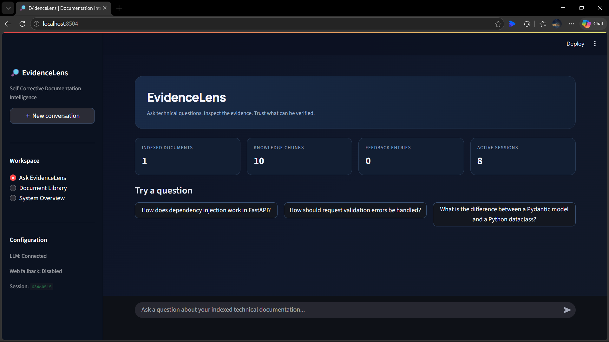
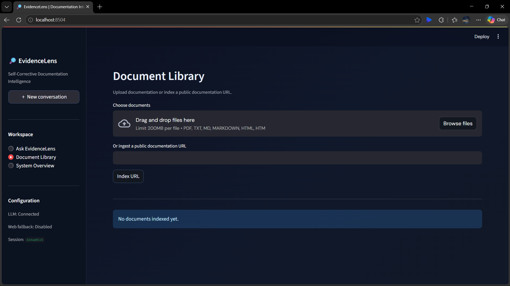
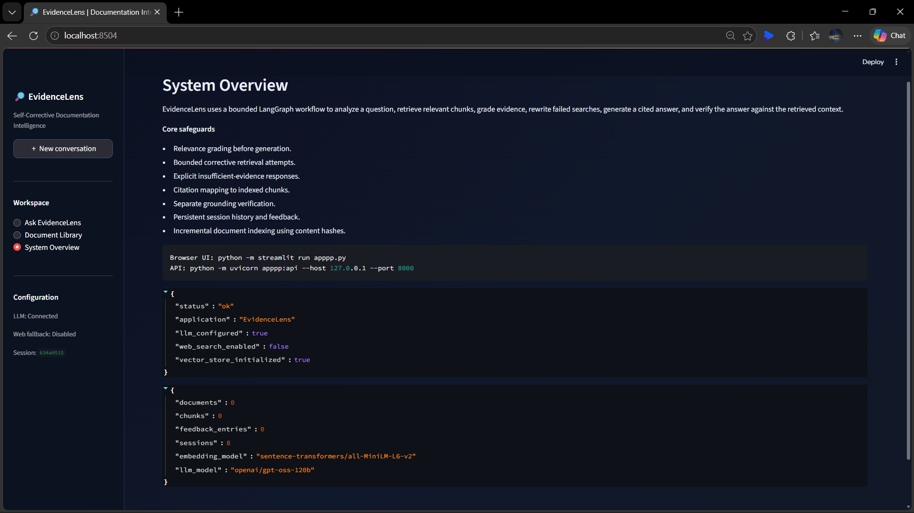
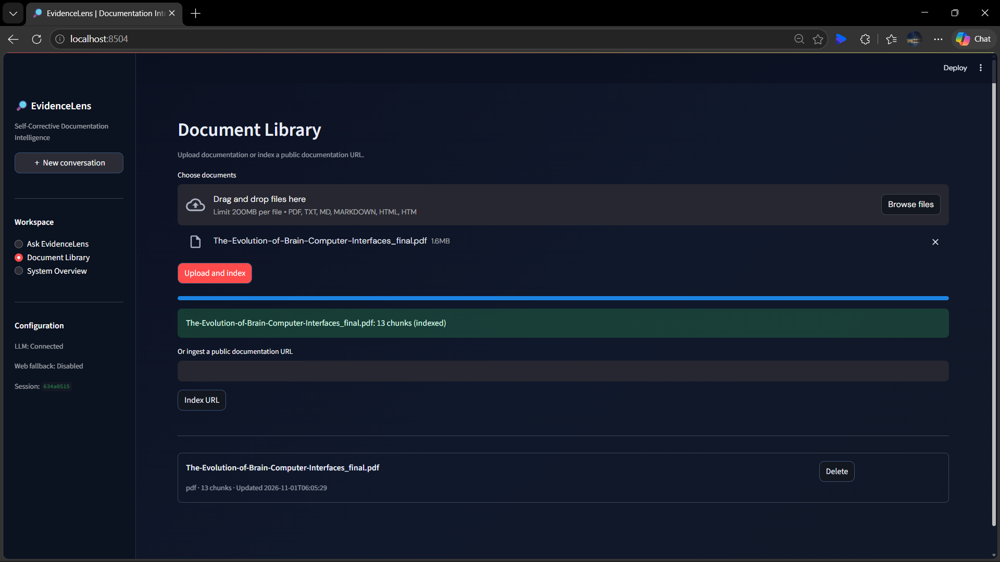
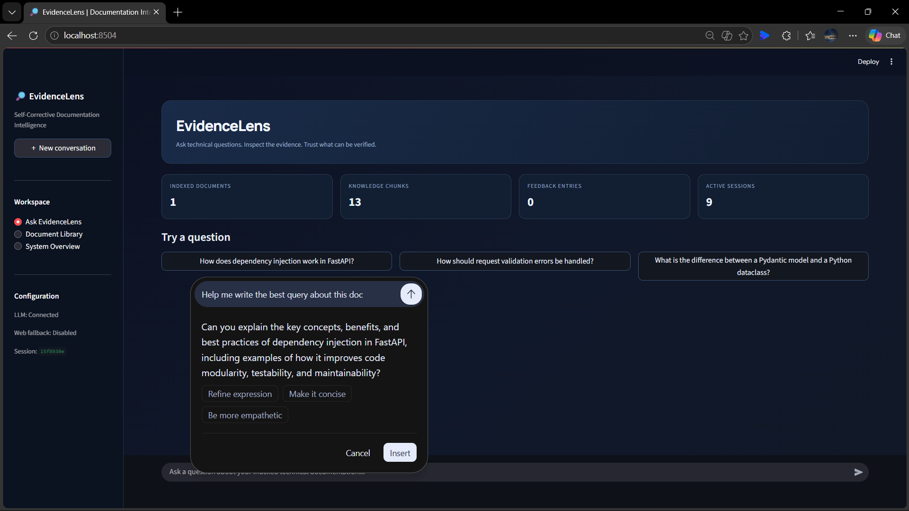
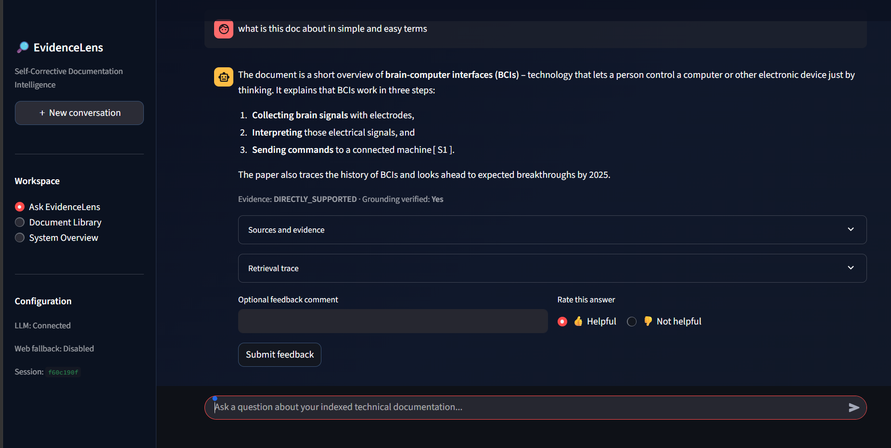
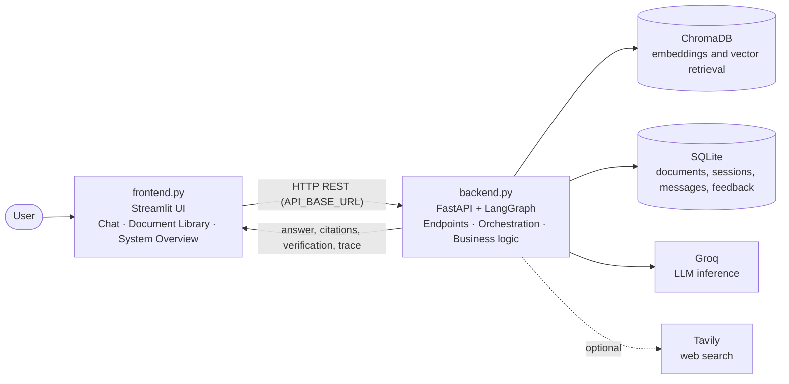
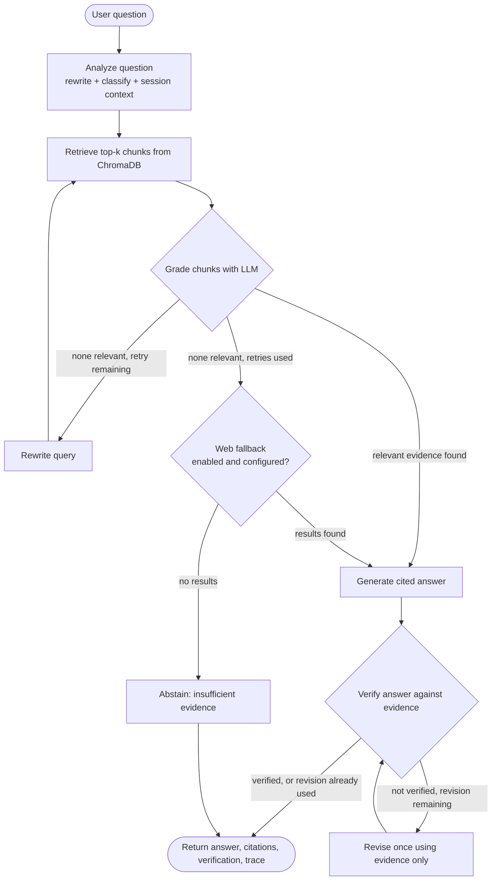

<div align="center">

# 🔎 EvidenceLens

### An evidence-grounded technical documentation assistant built on a self-corrective RAG workflow.


**Ask a technical question → inspect the evidence → see how well the answer is supported.**

</div>

---

<div align="center">

### A glimpse of the user interface with working insights

<table>
  <tr>
    <td align="center"></td>
    <td align="center"></td>
    <td align="center"></td>
  </tr>
  <tr>
    <td align="center"></td>
    <td align="center"></td>
    <td align="center"></td>
  </tr>
</table>

</div>

---

## The Problem

Technical documentation is long, spread across files, and easy to misread. A basic retrieve-and-generate pipeline helps, but it gives little protection when retrieval returns the wrong passages or when the model says more than the sources support, and the reader has no easy way to tell.

## The Approach

EvidenceLens treats retrieval as something to **check**, not assume:

1. **It grades its own retrieval.** An LLM judges every retrieved chunk for relevance before any answer is written.
2. **It corrects a failed search.** If nothing relevant is found, it rewrites the query and retrieves again, within a fixed retry limit.
3. **It shows its sources.** Answers carry inline source identifiers (`[S1]`, `[S2]`) that map to document, section and chunk references. The UI exposes excerpts, relevance verdicts, scores and a retrieval trace.
4. **It assesses its own answer.** A separate LLM-based grounding step compares the answer with the evidence, assigns an evidence status, and allows one bounded revision when claims are unsupported.
5. **It declines when evidence is missing.** If no usable evidence is found, it says so instead of guessing.

---

## Assignment Coverage

Every requirement in the take-home brief is implemented, along with all four optional bonus items.

### Core requirements

| Requirement | Status | Where it lives (`backend.py`) |
|---|---|---|
| LangGraph `StateGraph` workflow | ✅ | `build_graph()` |
| **Node 1** – Query analysis (rewrite + query-type classification) | ✅ | `analyze_query()` → `analyze` node |
| **Node 2** – Retrieval from a vector store with source metadata | ✅ | `retrieve()` → ChromaDB, top-k + scores |
| **Node 3** – LLM document grading (relevant / irrelevant, filter) | ✅ | `grade_chunks()` → `grade` node |
| **Node 4** – Generation with citations | ✅ | `generate_answer()` → `generate` node |
| Conditional edge on grading, with rewrite + retry limit | ✅ | `route_after_grading()`, `MAX_RETRIES` |
| Thoughtful state schema, retry tracking | ✅ | `RAGState` (`retry_count`, `revision_count`, …) |
| Ingestion: files or URLs → chunk → embed → store | ✅ | `/ingest`, `split_into_chunks()`, `ingest_text()` |
| `POST /query`, `POST /ingest`, `GET /documents`, `POST /feedback` | ✅ | FastAPI app |
| Error handling, validation, meaningful status codes | ✅ | Pydantic models; 400 / 404 / 413 / 415 / 422 / 502 / 503 |
| Corpus ingestion + README + design write-up | ✅ | Upload files or index URLs via `/ingest`; this file |

### Bonus items

| Bonus | Status | Implementation |
|---|---|---|
| Hallucination check (Self-RAG style) | ✅ | LLM-based `verify_answer()` + one bounded `revise` step |
| Web-search fallback | ✅ | Optional Tavily fallback; results labelled separately (`[W#]`) |
| Conversation memory | ✅ | Session messages stored in SQLite; recent turns used during query analysis |
| Simple UI | ✅ | Streamlit chat, document library and system overview (`frontend.py`) |

### Additions beyond the brief

- **Four evidence statuses** assigned by the verifier: `DIRECTLY_SUPPORTED`, `PARTIALLY_SUPPORTED`, `INSUFFICIENT_EVIDENCE`, `CONTRADICTORY_EVIDENCE`.
- **Explicit abstain path** when no usable evidence is found.
- **Separate frontend and backend:** `frontend.py` contains no RAG logic and talks to `backend.py` only over HTTP.
- **Incremental indexing:** a document from the same source with unchanged content (SHA-256 hash) is skipped; changed content is re-indexed in place.
- **URL validation safeguards:** only HTTP/HTTPS, local and internal hostnames rejected, hostnames resolved and non-public addresses blocked, redirects disabled, content capped at 8 MB.
- **Upload safeguards:** extension allow-list, configurable size limit (default 20 MB), filename sanitising.
- **Heading-aware chunking** that stores a `section` label with every chunk, so citations include the section.
- **Inspectable retrieval:** per-chunk scores, relevance verdicts and grading reasons are returned by the API and shown in the UI.
- **Feedback collection** with SQLite storage and a CSV export helper (`python backend.py export-feedback`).
- **Operational endpoints:** `/health`, `/stats`, `/sessions/{id}`, `DELETE /documents/{id}`.
- **Environment-based configuration** for models, limits and CORS (see [Configuration](#configuration)).

---

## Architecture

### Application architecture



| File | Responsibility |
|---|---|
| `backend.py` | API endpoints, LangGraph workflow, ingestion, chunking, retrieval, grading, generation, verification, storage |
| `frontend.py` | Chat interface, document library, system overview. Displays what the backend returns, including sources and the retrieval trace, and runs no RAG logic itself |

The two files connect through `API_BASE_URL` (default `http://127.0.0.1:8000`), so each can be read, run and reviewed on its own.

### LangGraph workflow



**Bounded by design:** corrective retrieval defaults to one retry (`MAX_RETRIES`), answer revision happens at most once, and the graph also runs with a recursion limit of 30.

**State tracked across nodes:** question, session history, rewritten query, query type, retrieved / graded / relevant chunks, `retry_count`, web results, answer, evidence status, verification result, `revision_count`, and timing.

### Design of each stage

| Stage | What it does | Why |
|---|---|---|
| **Analyze** | One LLM call returns JSON: rewritten query + query type. Resolves pronouns from recent history. Falls back to the original question if the output is unusable. | Better retrieval and working follow-ups, without failing on malformed output. |
| **Retrieve** | Cosine-similarity search over normalised `all-MiniLM-L6-v2` embeddings; returns text, metadata and score. | Fast, local, no embedding API cost. |
| **Grade** | A single batched LLM call grades all chunks (`relevant`, `support`, `reason`); a similarity threshold acts as a secondary guard. | One request instead of *k*; the LLM judges relevance and scores are only a safeguard. |
| **Generate** | Answers from the supplied evidence, cites `[S#]` / `[W#]`, states what is missing, describes conflicts. | Auditable, evidence-based answers. |
| **Verify** | A separate LLM evaluator checks material claims and citation IDs against the evidence and assigns the evidence status. | Flags unsupported claims; also provides the status without an extra classification call. |
| **Revise** | One bounded rewrite that removes unsupported claims, followed by re-verification. | Self-correction with a predictable cost. |

---

## Quick Start

### 1. Install

```bash
python -m venv .venv
```

Activate the environment:

```bash
# Windows
.venv\Scripts\activate

# macOS / Linux
source .venv/bin/activate
```

Install dependencies:

```bash
python -m pip install --upgrade pip
pip install -r requirements.txt
```

`requirements.txt` installs both parts. They can also be installed separately:

| File | Installs |
|---|---|
| `requirements-backend.txt` | FastAPI, LangGraph, LangChain components, ChromaDB, Sentence Transformers, Groq client, document parsers |
| `requirements-frontend.txt` | Streamlit and the HTTP client |

### 2. Configure

Copy `.env.example` to `.env` and add your own key. **Never commit `.env`.**

```env
GROQ_API_KEY=your_groq_api_key
GROQ_MODEL=openai/gpt-oss-120b
```

If Groq changes model availability, set `GROQ_MODEL` to any model enabled for your account. Both `backend.py` and `frontend.py` read the same `.env`, so run them from the project folder.

### 3. Run (two terminals, same virtual environment)

```bash
# Terminal 1: Backend (API)
python -m uvicorn backend:api --host 127.0.0.1 --port 8000

# Terminal 2: Frontend (UI)
python -m streamlit run frontend.py
```

Start the backend first so the UI can connect to it.

| Service | URL |
|---|---|
| Streamlit UI | http://localhost:8501 |
| Interactive API docs (Swagger) | http://127.0.0.1:8000/docs |
| Health check | http://127.0.0.1:8000/health |

### 4. Index your documents

Open **Document Library** and upload files or paste a public documentation URL. You can also call `POST /ingest` directly (see [API Reference](#api-reference)). Then open **Ask EvidenceLens** and start asking questions.

**Supported formats:** PDF, TXT, MD, Markdown, HTML and HTM, plus public HTTP/HTTPS pages.

> The first indexing run downloads the embedding model, so it takes longer. After that, the model and vector store are reused.

---

## API Reference

| Method | Endpoint | Purpose |
|---|---|---|
| `GET` | `/health` | Application and configuration status |
| `POST` | `/query` | Process a question through the RAG workflow |
| `POST` | `/ingest` | Upload a file (`file`) or submit a URL (`url`) as form data |
| `GET` | `/documents` | List indexed documents |
| `DELETE` | `/documents/{document_id}` | Delete a document and its vectors |
| `POST` | `/feedback` | Store thumbs up / down (`up` / `down`) with an optional comment |
| `GET` | `/stats` | Document, chunk, feedback and session counts |
| `GET` | `/sessions/{session_id}` | Retrieve stored conversation messages |

`/health` reports application and configuration status (for example, whether an LLM key is configured and whether the vector store has been initialised). It does not test the reachability of every dependency.

**Status codes:** `400` invalid ingest input · `404` not found · `413` file too large · `415` unsupported file type · `422` request validation error · `502` pipeline failure · `503` LLM not configured.

### Example requests

**Ask a question**

```bash
curl -X POST http://127.0.0.1:8000/query \
  -H "Content-Type: application/json" \
  -d '{"question":"How does a LangGraph conditional edge work?","session_id":"demo-session"}'
```

On Windows PowerShell, use `curl.exe` and escape the quotes:

```powershell
curl.exe -X POST http://127.0.0.1:8000/query -H "Content-Type: application/json" -d "{\"question\":\"How does a LangGraph conditional edge work?\",\"session_id\":\"demo-session\"}"
```

**Response structure** (values are illustrative and depend on your documents and model):

```json
{
  "question": "How does a LangGraph conditional edge work?",
  "answer": "A conditional edge calls a routing function with the current state and uses its return value to choose the next node [S1].",
  "evidence_status": "DIRECTLY_SUPPORTED",
  "citations": [
    {
      "citation_id": "S1",
      "document_name": "langgraph_stategraph.md",
      "section": "Conditional edges",
      "chunk_id": "<document_id>:3",
      "source_type": "md",
      "url": null,
      "excerpt": "…",
      "retrieval_score": 0.71
    }
  ],
  "verification": {
    "verified": true,
    "evidence_status": "DIRECTLY_SUPPORTED",
    "unsupported_claims": [],
    "summary": "…"
  },
  "session_id": "demo-session",
  "trace": {
    "rewritten_query": "…",
    "query_type": "conceptual",
    "retrieved_chunks": 5,
    "relevant_chunks": 2,
    "rejected_chunks": 3,
    "retry_attempts": 0,
    "web_fallback_used": false,
    "retrieval_seconds": 0.05,
    "total_seconds": 4.2,
    "revision_attempts": 0
  },
  "retrieved_evidence": [
    {
      "text": "…",
      "metadata": { "document_name": "…", "section": "…", "chunk_id": "…" },
      "score": 0.71,
      "relevant": true,
      "grade_reason": "…"
    }
  ]
}
```

**Other calls**

```bash
curl http://127.0.0.1:8000/health
curl http://127.0.0.1:8000/documents
curl -X POST http://127.0.0.1:8000/ingest -F "file=@your_document.md"
curl -X POST http://127.0.0.1:8000/ingest -F "url=https://example.com/docs/page.html"
curl -X POST http://127.0.0.1:8000/feedback -H "Content-Type: application/json" \
  -d '{"question":"How do conditional edges work?","answer":"They route based on state.","rating":"up","comment":"Clear answer"}'
curl http://127.0.0.1:8000/sessions/demo-session
```

---

## Chunking & Embedding Strategy

**Chunking.** A heading-aware character chunker:

1. Markdown headings (and ALL-CAPS section titles) start a new section, so a chunk does not straddle two topics.
2. Each section is split into chunks of up to **900 characters** with a **130-character overlap**, preferring paragraph or sentence boundaries.
3. Each chunk stores its `section`, so citations point to a place in the document, not just a file.

*Why:* technical documents are organised by headings, so a section is a natural unit of meaning. 900 characters keeps prompts compact while holding a full explanation or a small code example, and the overlap protects ideas that cross a boundary.

**Embeddings.** `sentence-transformers/all-MiniLM-L6-v2` with normalised vectors, cosine distance in ChromaDB, default top-k of 5. It runs locally (CPU by default), so there is no per-query embedding cost and no extra API key.

**Chunk metadata:** document ID and name, source, source type, section, chunk ID, chunk index, content hash.

**Citation granularity:** citations reference the document, section and chunk. PDF text is tagged with `[Page N]` markers during extraction, but citations are not guaranteed to be page-precise.

---

## Configuration

### Defaults at a glance

| Setting | Default |
|---|---|
| LLM provider / model | Groq / `openai/gpt-oss-120b` |
| Embedding model | `sentence-transformers/all-MiniLM-L6-v2` (CPU) |
| Vector database | ChromaDB (cosine distance) |
| Metadata and conversation database | SQLite |
| Top-K retrieval | 5 |
| Corrective retrieval attempts | 1 |
| Similarity threshold | 0.20 |
| Chunk size / overlap | 900 / 130 characters |
| Maximum file upload | 20 MB |
| Maximum URL content | 8 MB |
| Web fallback | Disabled |

Chunk size, overlap and the URL content cap are constants in `backend.py`; the rest are environment variables.

### Environment variables

| Variable | Default | Purpose |
|---|---|---|
| `GROQ_API_KEY` | — | **Required** for question answering |
| `GROQ_MODEL` | `openai/gpt-oss-120b` | Groq model name |
| `EMBEDDING_MODEL` | `sentence-transformers/all-MiniLM-L6-v2` | Embedding model |
| `EMBEDDING_DEVICE` | `cpu` | Embedding device |
| `TOP_K` | `5` | Chunks retrieved per search |
| `MAX_RETRIES` | `1` | Query-rewrite retries |
| `SIMILARITY_THRESHOLD` | `0.20` | Secondary relevance guard |
| `MAX_UPLOAD_MB` | `20` | Upload size limit |
| `ENABLE_WEB_SEARCH` | `false` | Enable Tavily fallback (also requires `TAVILY_API_KEY`) |
| `TAVILY_API_KEY` | — | Tavily key, used only when web search is enabled |
| `CORS_ORIGINS` | `http://localhost:8501` | Comma-separated allowed origins |
| `API_BASE_URL` | `http://127.0.0.1:8000` | Backend URL used by the UI |
| `EVIDENCELENS_DATA_DIR` | `./data` | Runtime data location |
| `CHROMA_COLLECTION` | `evidencelens` | Chroma collection name |
| `LOG_LEVEL` | `INFO` | Logging level |

---

## Project Structure

```
EvidenceLens/
├── images/                     # UI screenshots used in this README
├── backend.py                  # FastAPI + LangGraph workflow + ingestion + storage
├── frontend.py                 # Streamlit user interface
├── requirements.txt            # Installs backend + frontend dependencies
├── requirements-backend.txt    # Backend dependencies
├── requirements-frontend.txt   # Frontend dependencies
├── .env.example                # Template for environment variables
├── .gitignore
├── .python-version
└── README.md
```

Created automatically at runtime in `data/`: `chroma/` (vectors), `evidencelens.db` (SQLite: documents, sessions, messages, feedback), `uploads/` (reserved).

---

## Performance Decisions

- The embedding model, Chroma client, LLM client and compiled graph are **initialised lazily once** and reused.
- The embedding model is **not loaded** while the document library is empty.
- Grading is **one batched LLM call**, not one per chunk.
- The verifier also returns the evidence status, avoiding a separate classification call.
- Retries, revisions, timeouts and LLM retries are all **bounded**.
- Vectors are added in **batches** to limit memory use; SQLite connections are short-lived with a busy timeout.

The first embedding-model download is a one-time cold-start cost on CPU-only machines. No benchmark figures are claimed; the `trace` returned by `/query` reports retrieval and total time for each request.

---

## Security Notes

- URL ingestion accepts only HTTP/HTTPS, rejects local and internal hostnames, resolves the hostname and blocks non-public addresses, disables redirects, and caps downloaded content at 8 MB.
- Uploads are limited by extension and size, and filenames are reduced to their base name.
- CORS origins are configurable and default to the local Streamlit address.
- API keys are read from environment variables and are not stored in the repository.

These are validation safeguards for a local application, not a guarantee of complete protection. Public deployment would call for additional controls (authentication, rate limiting, network-level egress filtering).

---

## Design Decisions & Trade-offs

- **Groq + local embeddings:** hosted inference for generation, with embeddings computed locally at no per-query cost.
- **LLM grading instead of keyword overlap:** keyword matching tends to mark almost anything relevant, while an LLM judges whether a chunk actually helps. The trade-off is one extra call and some non-determinism.
- **Bounded loops:** retries and revisions are capped so latency and cost stay predictable.
- **Abstain over guess:** in documentation tooling, "not enough evidence" is more useful than a confident but unsupported answer.
- **Separate frontend and backend files:** each part can be reviewed, run and deployed independently, and they communicate only over HTTP.
- **Character-based, heading-aware chunking:** simple and transparent. Token-aware or code-block-aware splitting would suit production corpora better.
- **Web search is off by default** and, when enabled, is labelled separately from indexed evidence.
- **Bring your own corpus:** the system is corpus-agnostic, so you index the technical documents you need.
- **Assumption:** documents are English-language technical text.

---

## Scope & Limitations

- **Verification is LLM-based.** It is an automated grounding assessment, not a guarantee of factual correctness. Read the cited excerpts for anything high-stakes.
- **LLM grading is probabilistic.** It may occasionally reject a useful chunk or accept a marginal one; per-chunk verdicts and reasons are exposed so this can be inspected.
- **Scanned PDFs are not supported.** Documents without a text layer are rejected (no OCR).
- **Chat display and stored history.** The visible chat is held in Streamlit session state. Messages are also stored in SQLite and used for follow-up questions, and can be retrieved through `GET /sessions/{session_id}`.
- **Local persistence by default.** SQLite and ChromaDB write to local directories. A cloud deployment needs persistent storage if data must survive restarts or redeployments.
- **Key configuration versus reachability.** Configuring `GROQ_API_KEY` does not confirm that the model service is reachable; request failures are reported with a `502` or `503`.
- **Prototype scope.** Built as a local take-home application, not a multi-tenant production service.

---

## Suggested Test Checklist

1. Ask a question your indexed documents answer directly; check that the citations match the excerpts.
2. Ask a follow-up in the same session ("Explain that in simpler words") to exercise conversation memory.
3. Ask an unrelated question and confirm it retries once, then returns an insufficient-evidence response.
4. Upload a second document and confirm `GET /documents` lists both.
5. Re-upload the same file and confirm the status is `unchanged`.
6. Send feedback with `POST /feedback` and confirm the feedback count rises in `/stats`.
7. Restart the API and confirm documents and stored history persist (`GET /documents`, `GET /sessions/{id}`).

---

## Planned Improvements

- Restore a saved conversation in the UI from `GET /sessions/{session_id}`.
- Show backend configuration and connection status in the UI from `/health`.
- Automated unit and integration tests (graph routing, citation integrity, API validation).
- Hybrid lexical + vector retrieval with a cross-encoder reranker.
- OCR and structured ingestion for DOCX, PPTX, XLSX and scanned PDFs.
- Token-aware and code-aware chunking; source-version tracking.
- Authentication, rate limiting and background ingestion jobs.
- An evaluation set measuring retrieval recall, answer faithfulness, citation precision and latency.

---

## Tech Stack

**Python** · **FastAPI** · **Uvicorn** · **Pydantic** · **LangGraph** · **LangChain** (core, Groq, HuggingFace, Chroma integrations) · **ChromaDB** · **Sentence Transformers** · **Groq** · **SQLite** · **Streamlit** · **Requests** · **pypdf** · **python-dotenv** · **Tavily** (optional)
