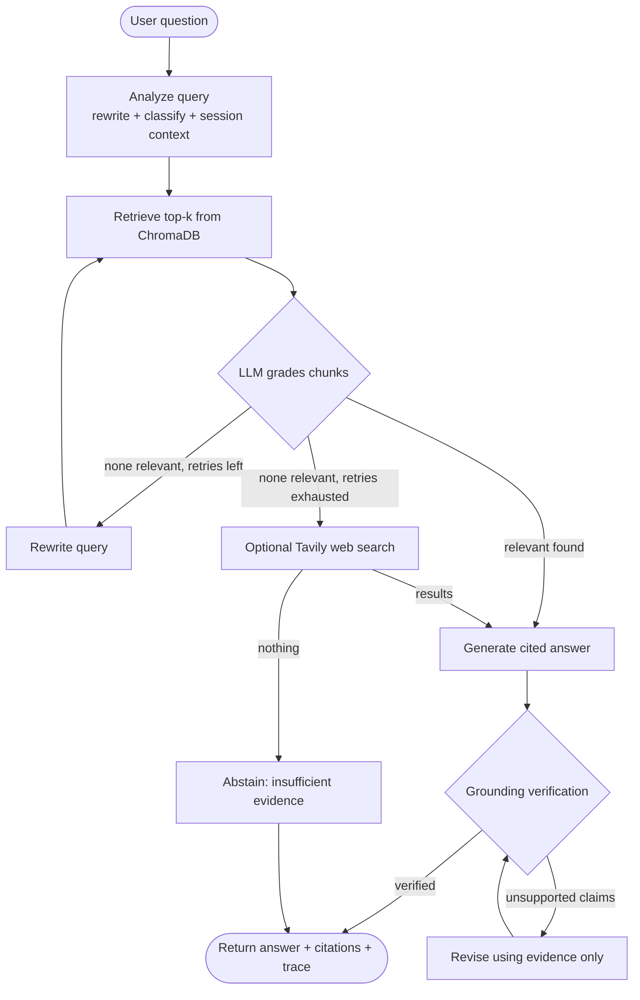

<div align="center">

# 🔎 EvidenceLens

### A self-corrective RAG assistant that answers technical-documentation questions, cites its sources, and checks its own work.


**Ask a technical question → inspect the evidence → trust only what can be verified.**

</div>

---

## Why EvidenceLens?

A basic RAG pipeline retrieves chunks and hopes the LLM behaves. EvidenceLens treats retrieval as something to **verify**, not assume:

1. **It doubts its own retrieval.** An LLM grades every retrieved chunk for relevance before any answer is written.
2. **It corrects itself.** If nothing relevant is found, it rewrites the query and retrieves again, within a hard retry limit.
3. **It shows its work.** Every claim is cited (`[S1]`, `[S2]`), and the UI exposes excerpts, grades, scores and a retrieval trace.
4. **It checks its answer.** A separate grounding step compares the answer against the evidence and triggers one bounded revision if claims are unsupported.
5. **It knows when to stop.** If the evidence is not there, it says so instead of guessing.

---

## Assignment Coverage

Every requirement of the take-home brief is implemented, along with all four optional bonus items.

### Core requirements

| Requirement | Status | Where it lives |
|---|---|---|
| LangGraph `StateGraph` workflow | ✅ | `build_graph()` |
| **Node 1** – Query analysis (rewrite + query-type classification) | ✅ | `analyze_query()` → `analyze` node |
| **Node 2** – Retrieval from a vector store with source metadata | ✅ | `retrieve()` → ChromaDB, top-k + scores |
| **Node 3** – LLM document grading (relevant / irrelevant, filter) | ✅ | `grade_chunks()` → `grade` node |
| **Node 4** – Generation with citations | ✅ | `generate_answer()` → `generate` node |
| Conditional edge on grading, with rewrite + retry limit | ✅ | `route_after_grading()`, `MAX_RETRIES` |
| Thoughtful state schema, retry tracking | ✅ | `RAGState` (`retry_count`, `revision_count`, …) |
| Ingestion: files or URLs → chunk → embed → store | ✅ | `/ingest`, `split_into_chunks()`, `ingest_text()` |
| `POST /query`, `POST /ingest`, `GET /documents`, `POST /feedback` | ✅ | FastAPI app |
| Error handling, validation, meaningful status codes | ✅ | Pydantic models, 400/404/413/415/502/503 |
| Corpus + README + design write-up | ✅ | `docs/`, this file |

### Bonus items

| Bonus | Status | Implementation |
|---|---|---|
| Hallucination check (Self-RAG style) | ✅ | `verify_answer()` + bounded `revise` loop |
| Web-search fallback | ✅ | Tavily, optional, labelled separately (`[W#]`) |
| Conversation memory | ✅ | Per-session history in SQLite, used in query analysis |
| Simple UI | ✅ | Streamlit chat, document library, system overview |

### Additions beyond the brief

- **Five-state evidence status** from the verifier: `DIRECTLY_SUPPORTED`, `PARTIALLY_SUPPORTED`, `INSUFFICIENT_EVIDENCE`, `CONTRADICTORY_EVIDENCE`.
- **Explicit abstain path** when no usable evidence exists.
- **Incremental indexing:** content hashes skip unchanged documents and re-index changed ones in place.
- **SSRF-aware URL ingestion:** DNS resolution check, private/loopback/reserved IPs blocked, redirects disabled, 8 MB cap.
- **Upload safeguards:** extension allow-list, configurable size limit, filename sanitising.
- **Heading-aware chunking** that carries a `section` label into every citation.
- **Inspectable retrieval:** per-chunk scores, relevance verdicts and grading reasons returned by the API.
- **Persistent feedback** with CSV export (`python apppp.py export-feedback`).
- **Operational endpoints:** `/health`, `/stats`, `/sessions/{id}`, `/ingest/sample`, `DELETE /documents/{id}`.
- **Fully configurable via environment variables** (see [Configuration](#configuration)).

---

## Architecture



**State tracked across nodes:** question, session history, rewritten query, query type, retrieved / graded / relevant chunks, `retry_count`, web results, answer, evidence status, verification result, `revision_count`, and timing. The graph runs with a recursion limit of 30 as a final safety net, on top of the explicit retry and revision caps.

### Design of each stage

| Stage | What it does | Why |
|---|---|---|
| **Analyze** | One LLM call returns JSON: rewritten query + query type. Resolves pronouns from the last turns of history. Falls back to the original question on failure. | Better retrieval, working follow-ups, no hard failure on malformed output. |
| **Retrieve** | Cosine-similarity search over normalised `all-MiniLM-L6-v2` embeddings; returns text, metadata and score. | Fast, local, no embedding API cost. |
| **Grade** | A single batched LLM call grades all chunks (`relevant`, `support`, `reason`), then a similarity threshold acts as a secondary guard. | One request instead of *k*; the LLM is the judge, scores are only a safeguard. |
| **Generate** | Answers strictly from supplied evidence, cites `[S#]` / `[W#]`, states what is missing, flags conflicts. | Grounded, auditable answers. |
| **Verify** | A separate evaluator checks every material claim and that every citation ID exists. | Catches unsupported claims; also assigns the evidence status (no redundant extra call). |
| **Revise** | One bounded rewrite that drops unsupported claims, then re-verified. | Self-correction without infinite loops. |

---

## Quick Start

### 1. Install

```bash
python -m venv .venv

# Windows
.venv\Scripts\activate
# macOS / Linux
source .venv/bin/activate

python -m pip install --upgrade pip
pip install -r requirements.txt
```

### 2. Configure

Copy `.env.example` to `.env` and add your own key. **Never commit `.env`.**

```env
GROQ_API_KEY=your_groq_api_key
GROQ_MODEL=openai/gpt-oss-120b
```

If Groq changes model availability, set `GROQ_MODEL` to any model enabled for your account.

### 3. Run (two terminals, same virtual environment)

```bash
# Terminal 1: API
python -m uvicorn apppp:api --host 127.0.0.1 --port 8000

# Terminal 2: UI
python -m streamlit run apppp.py
```

| Service | URL |
|---|---|
| Streamlit UI | http://localhost:8501 |
| Interactive API docs (Swagger) | http://127.0.0.1:8000/docs |
| Health check | http://127.0.0.1:8000/health |

### 4. Index the corpus

In the UI, open **Document Library → Index included sample corpus**, or call `POST /ingest/sample`. You can also upload your own PDF / TXT / Markdown / HTML files or paste a public documentation URL.

> The first indexing run downloads the embedding model, so it is slower. After that, the model and vector store are reused.

---

## Sample Corpus

Three focused technical documents ship in `docs/`:

| File | Topic |
|---|---|
| `fastapi_fundamentals.md` | FastAPI routing and dependency injection |
| `pydantic_validation.md` | Pydantic models and request validation |
| `langgraph_stategraph.md` | LangGraph state, nodes and conditional edges |

---

## API Reference

| Method | Endpoint | Purpose |
|---|---|---|
| `POST` | `/query` | Ask a question; returns answer, citations, verification, trace |
| `POST` | `/ingest` | Upload a file (`file`) or submit a URL (`url`) as form data |
| `GET` | `/documents` | List indexed documents |
| `POST` | `/feedback` | Thumbs up/down (`up` / `down`) with optional comment |
| `POST` | `/ingest/sample` | Index the bundled `docs/` corpus |
| `GET` | `/stats` | Document, chunk, feedback and session counts |
| `GET` | `/sessions/{session_id}` | Stored conversation history |
| `GET` | `/health` | Service and configuration status |
| `DELETE` | `/documents/{document_id}` | Remove a document and its vectors |

**Status codes:** `400` bad ingest input · `404` not found · `413` file too large · `415` unsupported type · `422` validation error · `502` pipeline failure · `503` LLM not configured.

### Example requests

**Ask a question**

```bash
curl -X POST http://127.0.0.1:8000/query \
  -H "Content-Type: application/json" \
  -d '{"question":"How does a LangGraph conditional edge work?","session_id":"demo-session"}'
```

On Windows PowerShell, use `curl.exe` and escape the quotes:

```powershell
curl.exe -X POST http://127.0.0.1:8000/query -H "Content-Type: application/json" -d "{\"question\":\"How does a LangGraph conditional edge work?\",\"session_id\":\"demo-session\"}"
```

**Illustrative response shape** (values will vary with your corpus and model):

```json
{
  "question": "How does a LangGraph conditional edge work?",
  "answer": "A conditional edge calls a routing function with the current state and uses its return value to choose the next node [S1].",
  "evidence_status": "DIRECTLY_SUPPORTED",
  "citations": [
    {
      "citation_id": "S1",
      "document_name": "langgraph_stategraph.md",
      "section": "Conditional edges",
      "chunk_id": "…:3",
      "source_type": "markdown",
      "excerpt": "…",
      "retrieval_score": 0.71
    }
  ],
  "verification": { "verified": true, "evidence_status": "DIRECTLY_SUPPORTED", "unsupported_claims": [], "summary": "…" },
  "session_id": "demo-session",
  "trace": {
    "rewritten_query": "…",
    "query_type": "conceptual",
    "retrieved_chunks": 5,
    "relevant_chunks": 2,
    "rejected_chunks": 3,
    "retry_attempts": 0,
    "web_fallback_used": false,
    "revision_attempts": 0,
    "total_seconds": 4.2
  }
}
```

**Other calls**

```bash
curl http://127.0.0.1:8000/documents
curl -X POST http://127.0.0.1:8000/ingest -F "file=@docs/langgraph_stategraph.md"
curl -X POST http://127.0.0.1:8000/ingest -F "url=https://example.com/docs/page.html"
curl -X POST http://127.0.0.1:8000/ingest/sample
curl -X POST http://127.0.0.1:8000/feedback -H "Content-Type: application/json" \
  -d '{"question":"How do conditional edges work?","answer":"They route based on state.","rating":"up","comment":"Clear answer"}'
```

---

## Chunking & Embedding Strategy

**Chunking.** A heading-aware character chunker:

1. Markdown headings (and ALL-CAPS section titles) start a new section, so a chunk never straddles two topics.
2. Each section is split into ~**900-character** chunks with **130-character** overlap, preferring paragraph or sentence boundaries.
3. Each chunk stores its `section`, so citations point to a place in the document, not just a file.

*Why:* technical docs are organised by headings, and a section is the natural unit of meaning. 900 characters keeps prompts compact while holding a full explanation or small code example; the overlap protects ideas that cross a boundary.

**Embeddings.** `sentence-transformers/all-MiniLM-L6-v2`, normalised, cosine distance in ChromaDB, default top-k of 5. It runs locally on CPU, so there is no per-query embedding cost or extra API key.

**Chunk metadata:** document ID and name, source, source type, section, chunk ID, chunk index, content hash.

---

## Configuration

All settings are environment variables with sensible defaults.

| Variable | Default | Purpose |
|---|---|---|
| `GROQ_API_KEY` | — | **Required** for question answering |
| `GROQ_MODEL` | `openai/gpt-oss-120b` | Groq model name |
| `EMBEDDING_MODEL` | `sentence-transformers/all-MiniLM-L6-v2` | Embedding model |
| `EMBEDDING_DEVICE` | `cpu` | Embedding device |
| `TOP_K` | `5` | Chunks retrieved per search |
| `MAX_RETRIES` | `1` | Query-rewrite retries |
| `SIMILARITY_THRESHOLD` | `0.20` | Secondary relevance guard |
| `MAX_UPLOAD_MB` | `20` | Upload size limit |
| `ENABLE_WEB_SEARCH` | `false` | Enable Tavily fallback |
| `TAVILY_API_KEY` | — | Needed if web search is enabled |
| `CORS_ORIGINS` | `http://localhost:8501` | Comma-separated allowed origins |
| `API_BASE_URL` | `http://127.0.0.1:8000` | Backend URL used by the UI |
| `EVIDENCELENS_DATA_DIR` | `./data` | Runtime data location |
| `CHROMA_COLLECTION` | `evidencelens` | Chroma collection name |
| `LOG_LEVEL` | `INFO` | Logging level |

---

## Project Structure

```
EvidenceLens/
├── apppp.py              # FastAPI backend + LangGraph workflow + Streamlit UI
├── requirements.txt
├── .env.example
├── README.md
└── docs/
    ├── fastapi_fundamentals.md
    ├── pydantic_validation.md
    └── langgraph_stategraph.md
```

Created automatically at runtime in `data/`: `chroma/` (vectors), `evidencelens.db` (SQLite: documents, sessions, messages, feedback), `uploads/` (reserved).

---

## Performance Decisions

- Embedding model, Chroma client, LLM client and compiled graph are **lazy-loaded once** and reused.
- The embedding model is **not loaded** if the library is empty.
- Grading is **one batched LLM call**, not one per chunk.
- The verifier also returns the evidence status, avoiding a redundant classification call.
- Retries, revisions, timeouts and LLM retries are all **bounded**.
- Vectors are added in **batches** to limit memory; SQLite connections are short-lived with a busy timeout.

The first embedding-model download is a one-time cold-start cost on CPU-only machines.

---

## Design Decisions, Assumptions & Trade-offs

- **Groq + local embeddings:** fast hosted inference, with no cost or rate limit on embedding.
- **LLM grading over keyword overlap:** keyword matching marks almost anything relevant; the LLM judges whether a chunk actually helps. The cost is one extra call and some non-determinism.
- **Bounded loops everywhere:** retries and revisions are capped so latency and cost stay predictable.
- **Abstain over guess:** a confident wrong answer is worse than "not enough evidence" in documentation tooling.
- **Single-file layout:** easy to review and run for a take-home. A larger project would split API, graph, ingestion and UI into modules.
- **Character-based chunking:** simple and transparent; token-aware or code-block-aware splitting would be better for production.
- **Web search is off by default** and, when on, is labelled separately from indexed evidence.
- **Assumption:** documents are English-language technical text.

### Known limitations (stated honestly)

- Grounding verification is an **LLM-based check, not a guarantee** against hallucination. For high-stakes use, read the cited excerpts.
- LLM grading is probabilistic and may occasionally reject a useful chunk or accept a marginal one.
- URL ingestion blocks obvious private/internal targets and disables redirects, but should get network-level controls (egress filtering, auth, rate limiting) before any public deployment.
- Scanned PDFs without a text layer are rejected (no OCR).
- This is a local prototype, not a hardened multi-tenant service.

---

## Suggested Test Checklist

1. Ask a question the corpus answers directly; check that the citations match.
2. Ask a follow-up in the same session ("Explain that in simpler words") to exercise memory.
3. Ask an unrelated question and confirm it retries, then abstains.
4. Upload a second document and confirm `GET /documents` lists both.
5. Re-upload the same file and confirm the status is `unchanged`.
6. Submit 👍 and 👎 feedback and watch the feedback count rise in `/stats`.
7. Restart the API and confirm documents and history persist.

---


## Tech Stack

**Python** · **LangGraph** · **LangChain** · **FastAPI** · **Pydantic** · **ChromaDB** · **Sentence Transformers** · **Groq** · **SQLite** · **Streamlit** · **Tavily** (optional)

---

<div align="center">

Built for the Express Analytics AI/ML Engineer Intern take-home assignment.

</div>
